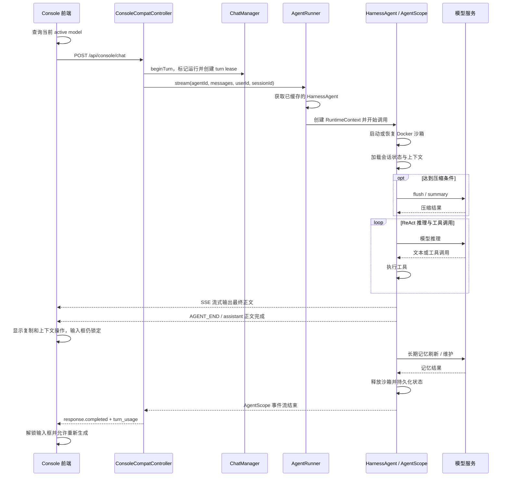

# 对话首尾延迟问题分析与修复状态

## 1. 文档目的

本文分析以下两个用户可感知的延迟问题，记录已实施修复和后续优化边界：

1. 用户发送消息后，界面长时间没有正文响应。
2. 回答正文已经显示完成，但底部的复制按钮和上下文大小按钮很久以后才出现。

分析基于 2026-07-25 的代码和 `logs/melon.log` 样本。文中标记为“已完成”的修改已经进入当前代码；其余内容仍是后续建议。

## 2. 结论摘要

| 问题 | 主要原因 | 次要因素 | 优先建议 |
| --- | --- | --- | --- |
| 对话开始停顿 | AgentScope 在正常推理前同步执行上下文压缩，压缩本身需要额外模型调用 | 旧配置按 50 条消息过早触发；大工具结果落盘失败曾导致上下文持续膨胀 | 默认已改为按模型上下文 token 比例触发，工具结果路径已修复；失败冷却属于后续稳定性增强 |
| 回答结束后按钮迟迟不出现 | 每轮回答后同步执行长期记忆刷新；后端又曾把整个 AgentScope 流结束作为唯一完成边界 | 前端组件默认只有在 response 状态为 done 时才显示按钮 | 记忆刷新已改为 5 分钟节流，正文完成和 response 完成已经拆分 |

已确认 `HarnessAgent` 会被缓存，并非每次对话都重新构建 Agent，因此不应把主要优化方向放在 Agent 创建上。

### 2.1 当前实施状态

| 项目 | 状态 | 当前实现 |
| --- | --- | --- |
| 大工具结果落盘路径 | 已完成 | Docker 写入 `/workspace/large_tool_results`，local 模式使用 Agent 工作区虚拟路径 |
| 50 条消息过早触发压缩 | 已完成 | 新增 `trigger_messages_enabled`，默认关闭消息数触发；仍按模型上下文 token 比例触发 |
| 长期记忆每轮刷新 | 已完成 | 使用 AgentScope 官方 `FlushTrigger.throttled(Duration.ofMinutes(5))`；会话日志仍每轮落盘 |
| 正文完成与后台完成拆分 | 已完成 | `AGENT_END` 完成 assistant 消息并发送 `in_progress` 快照；流结束后才发送 `response.completed` |
| 前端按钮提前显示 | 已完成 | 最终 assistant 消息完成后显示复制和上下文操作；输入框和重新生成仍等待整个 response 完成 |
| 压缩失败冷却/熔断 | 未完成 | 需要会话级失败状态和明确的重试恢复规则 |
| 后台预压缩 | 未完成 | 必须先具备 session version/CAS，当前不应异步写回 |

## 3. Java 对话主流程



主要代码入口：

- 前端发送与 active model 预查询：`console/src/pages/Chat/index.tsx`。
- HTTP/SSE 入口：`melon-app/src/main/java/com/melon/app/controller/ConsoleCompatController.java`。
- 会话轮次状态：`melon-app/src/main/java/com/melon/app/runner/ChatManager.java`。
- Agent 运行入口：`melon-app/src/main/java/com/melon/app/runner/AgentRunner.java`。
- Agent 缓存：`melon-core/src/main/java/com/melon/core/agent/MultiAgentManager.java`。
- 压缩、工具结果淘汰和记忆配置：`melon-core/src/main/java/com/melon/core/agent/MelonAgentFactory.java`。
- AgentScope 事件到前端协议的转换：`melon-app/src/main/java/com/melon/app/runner/MelonPawEnvelopeMapper.java`。

## 4. 问题一：发送消息后长时间没有正文响应

### 4.1 观测时间线

日志样本 `logs/melon.log:1482-1490`：

| 时间 | 事件 | 相对耗时 |
| --- | --- | --- |
| 21:37:42.160 | `AgentRunner` 收到 stream query | 起点 |
| 21:37:42.602 | Docker 沙箱启动完成 | 约 0.44 秒 |
| 21:37:42.982 | 上下文压缩触发：50 条消息、56,472 tokens | 约 0.82 秒后进入压缩 |
| 21:38:18.723 | 压缩完成 | 压缩约 35.74 秒 |
| 21:38:33.066 | 最终回答模型阶段结束 | 压缩后继续正常推理 |

这次请求的大部分启动等待来自同步压缩，而不是 Docker 沙箱启动。

### 4.2 直接原因与当前修复：压缩位于正常推理主链路

问题发生时，配置中存在以下组合：

- `enabled = true`；
- `compact_threshold_ratio = 0.8`；
- `trigger_messages = 50`，并直接传给 AgentScope；
- `keep_messages = 20`。

AgentScope 会在消息数或 token 数达到任一阈值时触发压缩。日志样本只有约 44% 的上下文占用，却因为达到 50 条消息而提前执行了一次约 35.7 秒的压缩。

当前新增了 `trigger_messages_enabled`，默认值为 `false`。`MelonAgentFactory.buildCompactionConfig(...)` 默认向 AgentScope 传入 `triggerMessages=0`，仅依据当前模型报告的上下文窗口和 `compact_threshold_ratio` 计算 token 阈值；只有显式设置 `trigger_messages_enabled=true` 时，`trigger_messages` 才生效。这样保留了需要按消息数量压缩的场景，同时不会把已有的 `trigger_messages: 50` 配置误当成强制策略。

压缩仍启用：

```java
.flushBeforeCompact(true)
.offloadBeforeCompact(true)
```

达到有效触发条件后，压缩仍会在本轮正常推理前执行。压缩需要刷新记忆和调用模型生成摘要，因此真正达到 token 压力阈值的长会话仍可能出现首字等待；这是 AgentScope 当前同步压缩生命周期的边界。

如果压缩模型发生 streaming EOF，当前行为是记录警告后继续正常推理。虽然业务没有直接失败，但失败调用已经消耗了等待时间，而且会话仍可能保持在触发阈值以上，导致后续轮次再次尝试。

日志中多次出现：

```text
Compaction failed, continuing without compaction:
HTTP transport error during streaming: SSE/NDJSON stream failed: EOF reached while reading
```

### 4.3 已修复的放大因素：大工具结果淘汰失败

日志多次显示 `web_fetch` 结果无法写入：

```text
Failed to write file '/large_tool_results/...'
```

原绝对路径 `/large_tool_results/...` 与 Docker 沙箱允许写入的工作区不匹配。淘汰失败后，大段工具结果继续留在上下文中，导致：

```text
大工具结果保留
  -> 上下文 token 增长
  -> 更频繁达到压缩阈值
  -> 压缩模型调用增加
  -> 首次正文延迟增加
```

同一日志样本中，压缩前临时裁剪 8 个工具结果释放了约 21,197 tokens，说明工具结果是上下文体积的重要组成部分。

当前 `MelonAgentFactory` 会按执行模式设置淘汰目录：Docker 使用工作区挂载点 `/workspace/large_tool_results`，local 使用沙箱文件系统的工作区虚拟路径。阈值、预览长度和豁免工具继续复用 AgentScope 官方 `ToolResultEvictionConfig`，不另造一套淘汰中间件。

### 4.4 已排除或影响较小的因素

- `MultiAgentManager` 缓存 Agent，当前不是每轮完整重建。
- Docker 容器在样本中约 0.26 秒完成创建，从请求到启动完成约 0.44 秒，属于次要固定开销。
- MCP 连接采用异步路径，没有证据表明它是本次几十秒停顿的主要原因。
- 前端每次发送前查询 active model 会增加一次网络往返，但无法解释几十秒的停顿。

## 5. 问题二：正文结束后底部按钮延迟出现

### 5.1 观测时间线

日志样本 `logs/melon.log:1495-1502`：

| 时间 | 事件 | 相对耗时 |
| --- | --- | --- |
| 21:38:33.066 | 最终回答的模型阶段结束，正文已产生 | 起点 |
| 21:39:00.465 | Agent `POST_CALL` 结束 | 约 27.40 秒 |
| 21:39:00.658 | Controller 收到整个流完成 | 约 27.59 秒 |

因此，“正文完成”和“请求完成”当前不是同一个时刻。

### 5.2 已修复的直接原因：每轮同步刷新长期记忆

`MelonAgentFactory.memoryConfig(...)` 原配置为：

```java
.flushTrigger(MemoryConfig.FlushTrigger.always())
```

这会在每轮调用结束阶段再次调用模型，从会话中提取长期记忆。周期性的 consolidation 还可能增加额外维护。日志时间差表明，正文后的 AgentScope 生命周期处理是约 27.6 秒延迟的主要区间；该区间可能同时包含记忆处理和少量持久化工作，后续应通过细分指标精确拆账。

聊天记录或 Agent 状态持久化与长期记忆提取不是同一能力。无需为了保存每轮会话内容而强制每轮执行一次记忆模型调用。

当前已经改为 AgentScope 官方 `FlushTrigger.throttled(Duration.ofMinutes(5))`。节流只控制 LLM 记忆提取，`MemoryFlushMiddleware` 的消息 offload 仍在每轮执行，因此不会牺牲历史会话完整性。

### 5.3 已修复的协议原因：正文完成事件被忽略

`MelonPawEnvelopeMapper` 原先忽略 `AGENT_END`：

```java
case AGENT_END -> List.of();
```

只有 AgentScope 整个事件流结束后，`finish()` 才发送 `response.completed` 和 `turn_usage`。这保证了任务持久化与客户端共享同一个最终完成边界，但也把用户界面绑定到了后台维护阶段。

AgentScope 前端依赖的 `Actions.js` 使用以下判断：

```javascript
if (!AgentScopeRuntimeResponseBuilder.maybeDone(props.data)) return null;
```

因此，在 response 状态尚未完成时，复制和 usage 区域不会渲染。`console/src/pages/Chat/turnUsage.ts` 还会在 SSE 流结束时补齐 trailing `turn_usage`，进一步说明上下文大小目前依赖接近流尾部的状态。

当前 `AGENT_END` 会完成最终 assistant 消息，并发送带 `assistant_status=completed` 的 `in_progress` 响应快照；只有事件流真正结束才发送 `response.completed`。前端 HostResponseCard 在该状态下允许显示复制和已有 usage/context 信息，但隐藏“重新生成”，输入框仍由完整 response 生命周期控制。

## 6. 优化方案

### 6.1 P0：修复大工具结果淘汰（已完成路径修复）

目标是阻止上下文无上限增长，从源头降低压缩频率。

已实施：

1. Docker 淘汰目录改为 `/workspace/large_tool_results`，保证位于当前 Agent 唯一挂载的工作区。
2. local 模式保留 `/large_tool_results` 虚拟路径，由 SANDBOXED 文件系统重定位到当前 Agent 工作区。
3. 落盘成功后的预览、大小、工具调用 ID 和可读取引用继续使用 AgentScope 官方实现。
4. 对 `web_fetch` 等大结果使用现有最大字符数和豁免工具配置。

仍待上游能力或本地通用适配：AgentScope 2.0 在落盘异常时仍保留完整结果。后续若上游没有提供失败降级扩展点，再增加通用的有界降级中间件，不能只为 `web_fetch` 写特例。

风险与验证：

- 需要确认模型后续确实能通过引用路径重新读取完整结果。
- Docker 与本地沙箱模式都要验证路径隔离，不能写出当前 Agent workspace。
- 截断策略必须保留错误信息和关键元数据，避免把失败伪装成成功。

### 6.2 P0：避免按固定消息数过早压缩（已完成）

当前默认策略只按模型上下文 token 压力触发压缩：

1. `trigger_messages_enabled=false` 时，向 AgentScope 传入 `triggerMessages=0`。
2. token 阈值使用模型实际 `contextWindowSize * compact_threshold_ratio` 计算。
3. 模型没有报告上下文窗口时才回退到 128K，避免正常模型被固定 128K 覆盖。
4. 需要按消息数控制的部署可显式开启开关并设置 `trigger_messages`。

这项调整不会关闭上下文保护；接近模型窗口上限时仍会正常压缩，只是不再因为消息较碎而在 token 占用较低时提前付出一次摘要模型调用。

### 6.3 P0：停止每轮刷新长期记忆（已完成）

已经将：

```java
MemoryConfig.FlushTrigger.always()
```

调整为：

```java
MemoryConfig.FlushTrigger.throttled(Duration.ofMinutes(5))
```

推荐策略：

| 场景 | 建议触发方式 |
| --- | --- |
| 普通连续聊天 | 5 至 10 分钟节流 |
| 临时或无长期记忆会话 | `never()` |
| 对记忆一致性要求高的会话 | 会话关闭、切换任务或显式保存时触发 |

AgentScope `MemoryConfig` 支持为记忆处理配置独立 `Model`。当前尚未增加独立 memory model 配置；需要时应复用现有 ProviderManager 和模型选择机制，不能绕开统一限流。

预期效果：大多数轮次不再发生正文后的额外记忆模型调用，按钮等待时间会显著缩短。该改动不应取消每轮必要的会话状态持久化。

### 6.4 P0：拆分“用户可见完成”和“后台处理完成”（已完成）

当前定义了两个明确的生命周期边界：

| 状态 | 含义 | 前端行为 |
| --- | --- | --- |
| `AGENT_END` 对应的 assistant 完成状态 | 最终 assistant 正文已经完整到达 | 立即允许复制并显示已经可用的 usage/context 信息 |
| `response.completed` | 记忆维护、状态保存和任务收尾均完成 | 标记整个运行完成，完成最终持久化状态同步 |

后端在 `AGENT_END` 时发出仍为 `in_progress` 的响应快照，没有提前复用 `response.completed`，因此 SDK 会继续消费后续事件。

前端按钮依赖“最终 assistant 消息完整”，而不是整个 response 完成。实现位于已有 HostResponseCard 覆盖层，没有修改 `console/node_modules`。

输入框不会在这个边界提前恢复，“重新生成”也保持隐藏；二者继续等待 `response.completed`，避免新一轮消息与上一轮后台状态写入互相覆盖。

### 6.5 P1：增强上下文压缩的稳定性

建议：

1. 为 `summary_model` 配置独立、快速、稳定的模型。
2. 对单次 streaming EOF 最多进行一次有界重试，并设置短超时。
3. 压缩失败后记录 session 级冷却时间，例如 5 分钟内不再自动尝试。
4. 连续失败达到阈值后熔断，直到上下文显著变化、模型配置变化或用户显式重试。
5. 摘要失败时采用确定性降级：优先移除已落盘的工具原文，保留最近若干轮、system prompt、长期记忆和必要工具摘要。
6. 不要只降低 `trigger_messages` 或 token 阈值；这可能增加压缩次数，使停顿更频繁。

### 6.6 P1：将压缩移动到回答后的后台阶段

在 P0 稳定后，可以在用户阅读本轮回答时提前准备下一轮压缩状态。此方案可以进一步降低下一轮首字等待，但必须解决状态竞争：

- 为会话状态增加单调递增的 version。
- 后台压缩基于 version N 计算，写回时使用 CAS；当前状态不是 N 时放弃旧结果。
- 同一 session 同时只允许一个压缩任务。
- 新消息到达时只允许短时间等待后台结果，超时后继续使用未压缩状态。
- 后台失败不能阻塞下一轮正常推理。

在没有 version/CAS 或等价 lease 保护前，不建议直接异步写回会话状态。

### 6.7 P2：减少固定开销

- 缓存 active model 查询结果，在模型切换、Agent 切换或配置更新时主动失效，避免每次发送前同步查询。
- 可评估 Docker 沙箱短时 warm TTL；当前样本收益小于 1 秒，同时会增加资源占用和隔离生命周期，需要设置容量和空闲回收上限。
- 保持现有 Agent 缓存，不需要为本问题重构 Agent 创建流程。

## 7. 建议的代码修改范围

| 文件或模块 | 建议改动 |
| --- | --- |
| `melon-core/.../MelonAgentFactory.java` | 调整 memory flush trigger；配置专用 memory/summary model；接入修复后的 eviction 行为 |
| `melon-core/.../ContextCompactConfig.java` | 如上游配置无法覆盖，增加压缩失败冷却、熔断等可配置项 |
| AgentScope eviction 中间件或本地适配层 | 使用 workspace 内路径，并实现落盘失败的有界降级 |
| `melon-app/.../MelonPawEnvelopeMapper.java` | 映射正文完成事件，同时保留最终 `response.completed` |
| `melon-app/.../ConsoleCompatController.java` | 维护 SSE 生命周期顺序和后台收尾状态 |
| `console/src/pages/Chat/index.tsx` | 复用 active model 缓存；消费正文完成状态 |
| 前端 Response/Actions 覆盖层 | 基于 assistant message 完成显示复制按钮，不直接修改 `node_modules` |
| `console/src/pages/Chat/turnUsage.ts` | 允许 usage 在正文完成后尽早更新，保留流结束 fallback |

## 8. 可观测性建议

当前日志可以推导总体延迟，但不能精确区分记忆 flush、consolidation 和持久化。建议为每轮记录统一的 `turnId/chatId/sessionId`，并增加以下时间点或 duration：

- `frontend_model_preflight_ms`
- `request_received_at`
- `turn_lease_acquired_ms`
- `agent_resolve_ms`
- `sandbox_start_ms`
- `state_load_ms`
- `compaction_offload_ms`
- `compaction_flush_ms`
- `compaction_summary_ms`
- `first_sse_ms`
- `first_text_delta_ms`
- `final_text_at`
- `memory_flush_ms`
- `memory_consolidation_ms`
- `state_persist_ms`
- `response_completed_at`

重点指标：

- TTFT：请求发出到第一个正文 token；工具事件不应误算为正文 TTFT。
- TTFI：请求发出到第一个任意 SSE，用于区分连接问题和模型问题。
- Tail latency：最终正文结束到按钮可用。
- Compaction success rate、失败原因、连续失败次数和冷却命中次数。
- Tool eviction success rate、落盘字节数和截断次数。

## 9. 实施顺序

### 第一阶段：低风险止损（部分完成）

1. 已修复 `/large_tool_results` 路径；落盘异常的有界降级仍待处理。
2. 已默认关闭固定消息数触发，压缩改为按模型上下文 token 比例触发。
3. 已将 memory flush 从 `always()` 改为 5 分钟节流。
4. 压缩模型已经支持 `summary_model`；独立 memory model 尚未接入配置。
5. 分阶段耗时指标尚未补齐。

### 第二阶段：改善交互完成时机（已完成）

1. 已映射 `AGENT_END` 为等价正文完成状态。
2. 前端已在正文完成时显示复制和已有上下文信息。
3. `response.completed` 仍作为后台处理和持久化完成边界。

### 第三阶段：增强长期稳定性

1. 增加压缩失败冷却、熔断和确定性降级。
2. 引入带 version/CAS 的后台预压缩。
3. 按指标评估 active model 缓存和沙箱 warm TTL 是否值得实施。

## 10. 验收标准

建议以压测和真实长会话共同验收：

1. 50 条以上消息且包含大工具结果的会话，不再出现 `/large_tool_results` 写入失败。
2. 普通未触发压缩的轮次，正文结束后 500 ms 内显示复制按钮；上下文信息尚未到达时可先显示占位状态，数据到达后无布局跳动地更新。
3. memory flush 节流窗口内，连续对话不产生每轮额外记忆模型调用。
4. 压缩模型发生 EOF 后，冷却窗口内下一轮不会再次执行同类压缩调用。
5. 后台处理失败不影响已经完整输出的回答和复制操作，但最终状态必须显示失败并留下可追踪日志。
6. 新一轮请求与上一轮后台处理并发时，不发生消息、摘要或 session state 覆盖。
7. 分别统计 P50、P95、P99 的 TTFT 和 Tail latency，并与修改前基线对比。

## 11. 预期收益与边界

- memory flush 节流可以直接消除大多数轮次正文后的额外模型等待；在当前样本中，该区间约为 27.6 秒，但实际收益取决于模型和会话状态。
- 修复工具结果淘汰可显著降低长会话进入压缩的概率，但已经膨胀的历史会话仍需一次成功压缩或离线清理。
- 专用快速压缩模型和失败冷却能控制最坏等待；只有将压缩安全地移出下一轮主链路，才能进一步降低触发压缩轮次的 TTFT。
- active model 缓存和 Docker warm TTL 只优化小额固定成本，不应先于上下文和记忆问题实施。

以上耗时来自单个明确日志样本，用于定位量级和因果顺序，不应直接当作所有会话的统计结论。上线前后需要依靠新增指标验证整体 P95/P99 改善。
